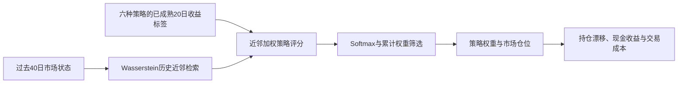
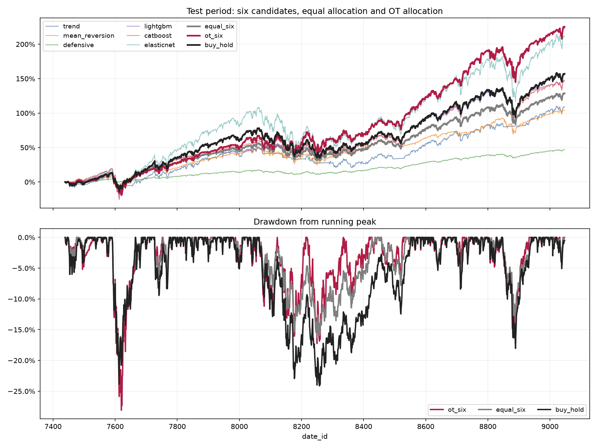

# Hull Tactical：基于最优运输的市场状态识别与动态策略配置

**用相似历史市场中的策略表现，决定今天如何配置仓位。**

本项目将过去40个交易日表示为一段市场状态轨迹，通过二阶 Wasserstein 距离检索相似历史，再根据近邻后续20日的策略收益，动态组合趋势、均值回归、防守、LightGBM、CatBoost 和 ElasticNet 六种策略。

当前研究定稿记录在 [research_snapshot.json](scripts/research_snapshot.json)，固定主 notebook 与对应结果文件的哈希。

在1,609个交易日的留出测试期内，六策略 OT 取得 **225.4% 累计净收益、20.3% 年化收益和 0.910 Sharpe**，累计收益超过六策略等权、买入并持有及最佳单策略 ElasticNet。

## 项目贡献

- **将市场状态相似性落到策略配置上。** 用53维多尺度滚动特征描述趋势、波动、回撤、因子水平与状态变化，加入相对时间坐标，形成 `40 × 54` 的市场轨迹。
- **统一规则策略和机器学习策略。** 在相同的仓位与交易成本计算下，比较六条单策略、等权配置和 OT 配置；训练期的模型策略历史由五折 walk-forward OOF 预测生成。
- **降低精确 OT 检索的计算量。** 利用均值、标准差构造 Wasserstein 距离下界，结合窗口缓存和分支剪枝，搜索精确的20个最近历史窗口。
- **提供可检查的回测证据。** 保存逐日仓位、策略评分、最终权重和净收益，并通过检查脚本核对配置规则、收益记账及汇总指标。



## 测试期结果

测试区间为 `date_id 7439–9047`，共1,609个交易日。所有账户从全现金开始，计算现金收益、持仓漂移和单边 **1 bp** 交易成本；下表收益均为扣费后的结果。

| 策略 | 累计净收益 | 年化收益 | 年化波动率 | Sharpe | 最大回撤 | 平均市场仓位 |
|---|---:|---:|---:|---:|---:|---:|
| **六策略 OT** | **225.4%** | **20.3%** | 19.5% | **0.910** | −28.1% | **93.5%** |
| ElasticNet | 211.9% | 19.5% | 23.4% | 0.767 | −31.5% | 130.4% |
| 买入并持有 | 157.1% | 15.9% | 17.8% | 0.771 | −24.1% | 100.0% |
| 六策略等权 | 128.7% | 13.8% | 14.4% | 0.787 | −23.6% | 74.5% |

OT 相对 ElasticNet 多获得 **13.5个百分点**累计收益，将平均市场仓位从1.304倍降至0.935倍，同时降低波动和回撤。相对买入并持有，组合承担更高的波动与回撤，取得更高的收益和 Sharpe。



测试期 ElasticNet 的平均策略权重为36.60%，两种树模型合计29.78%，三种规则策略合计33.62%。每日从六个候选中选入1–3种策略：248日选择一种、942日选择两种、419日选择三种。

数据来源：[完整指标](results/six_strategy_test/metrics.csv)、[权重汇总](results/six_strategy_test/weight_summary.csv)。图表和数值对应主研究 notebook 第五节的本地时序回测。

## 快速开始

### 1. 创建环境

在项目根目录运行，使用 Python 3.12：

```bash
python3.12 -m venv .venv
source .venv/bin/activate
python -m pip install -r requirements-dev.txt
```

Windows PowerShell 的激活命令为 `.venv\Scripts\Activate.ps1`。只检查已保存结果或使用 VS Code 的现有 notebook 内核时，可以先安装 `requirements.txt`。

依赖文件记录了本机 Python 3.12 研究环境中的直接依赖版本。

### 2. 准备数据

从 [Kaggle 官方数据页面](https://www.kaggle.com/competitions/hull-tactical-market-prediction/data)下载数据，在项目根目录新建 `archive/`，将 `train.csv` 放入其中。主研究使用的文件有9,048行、98列，`date_id` 为 `0–9047`。

研究中的1,609日测试期来自 `train.csv` 内部的时间切分。Kaggle提供的 `test.csv` 是推理接口样本，运行完整Python适配文件的本地接口检查时，将它一起放入 `archive/`。

### 3. 检查源码与已保存结果

```bash
# 无需原始数据：检查源码、逐日结果和汇总表的一致性
python scripts/validate_project.py --skip-data

# 有原始数据：进一步独立重算逐日净收益、Sharpe和换手率
python scripts/validate_project.py

# 小规模会计、时间边界和执行入口回归检查，无需训练模型
python -m unittest discover -s tests -v
```

### 4. 运行研究 notebook

```bash
# 先查看执行计划，不启动训练
python scripts/run_notebook.py --dry-run

# 冒烟检查：只运行市场特征构造和距离函数定义
python scripts/run_notebook.py --until-section 2

# 用已选定参数重做完整研究流程，跳过三轮超参数搜索
python scripts/run_notebook.py --mode fixed

# 执行包括三轮超参数搜索在内的全部代码
python scripts/run_notebook.py --mode search
```

执行器使用当前 Python 环境启动独立内核，从头运行所选章节，并将执行后的副本保存至 `.artifacts/`。完整运行到第五节时，会重新生成 `results/six_strategy_test/` 下的 CSV 与曲线；主 notebook 保留定稿。模型训练及逐日精确 OT 搜索是主要计算开销。

`fixed` 模式使用 notebook 中已经选定的模型参数；`search` 模式会额外生成三组参数搜索表，最佳参数字典仍由 notebook 显式指定。结果检查脚本会核对当前定稿及其导出文件的指纹，后续发布新实验时再一起更新定稿与指纹。

交互式阅读可用 VS Code 打开 [主研究 notebook](Optimal-transport-for-Hull-Tactical.ipynb)，或运行：

```bash
jupyter lab Optimal-transport-for-Hull-Tactical.ipynb
```

## 实验设计

数据共9,048行。排除覆盖率较低的前1,006行后，对剩余样本按时间顺序划分：

| 区间 | date_id | 交易日数 | 用途 |
|---|---|---:|---|
| 训练期 | 1006–5830 | 4,825 | 特征筛选、标准化、模型选择与 OOF 历史 |
| 验证期 | 5831–7438 | 1,608 | 比较基础策略及三模型配置 |
| 测试期 | 7439–9047 | 1,609 | 六策略统一回测 |

三个机器学习模型以未来20日市场相对现金的累计对数超额收益为预测目标，使用同一组80个原始输入特征。决策日 `t` 的模型输入滞后一天，OT 状态窗口为 `[t−40, t)`；填补与标准化在训练期拟合。五折 walk-forward 在训练和验证 fold 之间留19日 gap。

历史候选 `s` 须满足 `s + WINDOW + HORIZON ≤ t`，确保收益标签成熟并保留窗口间隔。已成熟的测试历史按相同规则逐步加入历史库。

| 固定参数 | 值 |
|---|---:|
| 市场窗口 `WINDOW` | 40日 |
| 策略标签 `HORIZON` | 20日 |
| 历史近邻 `K` | 20 |
| 距离温度 / 策略评分温度 | 1.0 / 0.01 |
| 窗口内相对时间坐标权重 | 5.0 |
| 策略筛选 | 最少数量，使累计 Softmax 权重严格超过50% |
| 单边交易成本 | 0.0001 |
| 机器学习策略市场仓位 | 0–2倍 |

Sharpe 使用净收益减现金收益计算，年化按252个交易日。负现金余额使用同一 `risk_free_rate` 计息。目标仓位为扣费后的市场比例，交易费用按调仓前漂移仓位与目标仓位之间的实际交易量计算。

## 项目结构

```text
.
├── Optimal-transport-for-Hull-Tactical.ipynb  # 主研究：五节完整叙述与已保存输出
├── hull_six_strategy_kaggle_submission.py    # 完整Kaggle推理适配
├── README.md
├── LICENSE
├── requirements.txt                         # 核心直接依赖
├── requirements-dev.txt                     # Notebook运行与编辑工具
├── scripts/
│   ├── run_notebook.py                      # 独立内核执行入口
│   ├── validate_project.py                  # 源码与回测产物一致性检查
│   └── research_snapshot.json               # 研究定稿与结果指纹
├── tests/test_research_contracts.py          # 交易记账、时间边界和入口检查
├── results/six_strategy_test/                # 当前第五节结果
└── .github/workflows/checks.yml             # 无原始数据的自动检查
```

## 完整 Python 推理适配

[`hull_six_strategy_kaggle_submission.py`](hull_six_strategy_kaggle_submission.py) 封装数据读取、模型训练、OOF策略历史、OT配置和逐行 `predict()` 接口。在Kaggle环境下连接竞赛推理服务器，本地运行时使用 `archive/test.csv` 检查输出仓位：

```bash
python hull_six_strategy_kaggle_submission.py
```

该适配采用分组PCA状态、100个候选预筛和0.5–2倍模型仓位。主研究 notebook 采用54维状态、精确剪枝检索和0–2倍模型仓位，README的225.4%结果对应主研究流程。

## 后续研究

- 在20日策略评分中加入波动率或回撤偏好，比较不同风险收益目标。
- 检验窗口长度、近邻数量、温度与交易成本变化下的配置表现。
- 使用滚动样本外区间和考虑标签重叠的区块重采样，评估结果稳定性。
- 将研究主流程提取为共享模块，使 Kaggle 适配与本地回测复用同一套状态和配置逻辑。

## 许可证与数据来源

项目代码和文档采用 [MIT License](LICENSE)。原始数据来自 [Kaggle Hull Tactical](https://www.kaggle.com/competitions/hull-tactical-market-prediction)，按其数据访问及竞赛规则使用。
